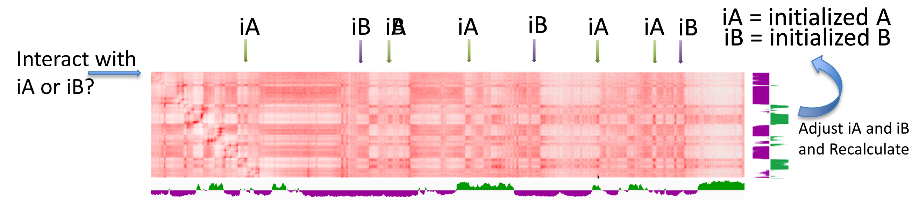

# CRUSH


### What is CRUSH?
CRUSH (**C**ompartmental **R**efinement for **U**ltraprecise **S**tratification within **H**i-C) is a tool that identifies fine-scale A/B compartments in chromatin conformation maps. It has been used on Hi-C, Micro-C and single-cell Hi-C. CRUSH calls compartments down to 1 kb resolution, and it needs far less read depth than eigenvector-based compartment calling.

CRUSH does not decompose the whole contact matrix. It measures how strongly each bin interacts with A-type and B-type reference regions, then refines those scores step by step from coarse to fine resolution. A is always positive and B is always negative, so the track never needs to be flipped.

#### Visual Algorithmic Explanation:


### Versions

| Version | What it is | Use it for |
|---|---|---|
| **crush-rs 0.2** (current) | A standalone Rust program that reads `.hic` files natively, keeps the pipeline in memory and runs chromosomes in parallel. | New analyses. |
| `crush-rs --v1` | A line-for-line port of the original bash pipeline, built into the same binary. Its known quirks are kept on purpose. | Regenerating tracks made with CRUSH v1. |
| `CRUSH_v1.0`, `CRUSHv1.1` (bash) | The original pipeline, used for the tracks in the first version of the paper. | Kept for the record only. |

See the [wiki](../../wiki) for full documentation, including how v2 differs from v1.

### How to install CRUSH

You need a Rust toolchain (1.81 or newer; https://rustup.rs) to build CRUSH:

```
git clone https://github.com/JRowleyLab/CRUSH.git
cd CRUSH
cargo build --release
# the binary is target/release/crush-rs
```

_Optional:_ UCSC `bedGraphToBigWig` on your `PATH`. If it is installed, CRUSH also writes bigWig files. If not, you get bedGraph files only.

CRUSH no longer needs bedtools, python, hicstraw or cooler.


### How to use CRUSH

_Required files:_

**HIC** (`-i`)

A `.hic` file from Juicer (`.hic` versions 6–9). Version 2 does not read `.mcool` files. To use an `.mcool`, convert it to `.hic` first: export the pairs (for example with `cooler dump --join`) and build a `.hic` with Juicer Tools `pre`, making sure to include every resolution you want CRUSH to walk through.

**SIZEFILE** (`-g`)

A two-column, tab-delimited file of chromosome names and lengths. Only the chromosomes listed here are analysed.

**ABED** (`-a`)

A BED file (at least 3 columns) of regions that mark the A compartment. We usually use gene annotations, but ChIP-seq peaks for an active mark also work.

**BBED** (`-b`)

A BED file of regions that mark the B compartment, or a genome FASTA file. If you give a FASTA, CRUSH picks low-GC 500 bp bins as B seeds.

**Keep chromosome names consistent between the size file, the BED files and the FASTA.** The `.hic` file can differ from them by a `chr` prefix; CRUSH matches names either way.


### Example usage

```
crush-rs -i Myfile.hic -g hg38.sizes -a hg38_genes.bed -b hg38.fa -r 1000 -c 16 -o Myfile_
```

The output is written to `CRUSHtracks/` (change this with `-O`).

The default settings are what we used throughout the paper. We do not recommend changing the advanced options unless you know what they do.

```
crush-rs -h      # common options
crush-rs -H      # every option, including the algorithm internals
```

```
REQUIRED:
  -i, --hic FILE          Input .hic file
  -g, --genomesize FILE   Chromosome sizes (2 columns: name, length)
  -a, --initialA FILE     BED seeding the A compartment (gene annotations)
  -b, --initialB FILE     BED seeding the B compartment, or a genome FASTA to
                          derive low-GC B seeds from

COMMON OPTIONS:
  -r, --res BP            Finest resolution to analyse            [default: 1000]
  -m, --maxres BP         Coarsest resolution to walk from     [default: 1000000]
  -c, --cpu N             Worker threads                            [default: 24]
  -o, --outpre PREFIX     Output filename prefix
  -O, --outdir DIR        Output directory                 [default: CRUSHtracks]
  -N, --norm TYPE         NONE | VC | VC_SQRT | KR | SCALE        [default: NONE]
  -v, --verbose           Verbose progress reporting
  -h, --help              This message
  -H, --help-advanced     Every option, including the algorithm internals
```

CRUSH walks through every resolution stored in the `.hic` file between `-m` and `-r`. The `.hic` file must therefore contain the resolution you ask for with `-r`.

To reproduce tracks made with the original bash pipeline:

```
crush-rs --v1 -i Myfile.hic -g hg19.sizes -a hg19_genes.bed -b hg19.fa -r 1000 -o Myfile_v1_
```

### Output Files

All files start with the prefix you gave with `-o`. `{res}` is the resolution you gave with `-r`.

| File | Contents |
|---|---|
| `mergedCrush_{res}.bedgraph` (and `.bw`) | The compartment track. A is positive and B is negative. Scores are rescaled so the mean \|score\| is 100, then capped at ±500 (`--clamp`). |
| `mergedqvalue_{res}.bedgraph` | Per-bin q-values. Written only with `-p 1`. |
| `mergedCrush_{res}_qfiltered.bedgraph` | The track restricted to bins with q ≤ `-q`. Written only with `-p 1`. |
| `Crush_{res}.bedgraph` | Tracks for single resolutions. Written only with `--keepres`. |

When a run finishes, CRUSH prints a **compartment check**. This is the contact enrichment within A and within B relative to A–B contacts, scored over the track's top and bottom quartiles. A value near 1.0 means the contact map does not support the track. CRUSH always produces a signed track, so a track that looks plausible is not, on its own, evidence that compartments are present. See the wiki for how to read this check.

### Time and memory

These are genome-wide figures for GM12878 / LCL Hi-C with 24 threads (Table S13 of the paper).

| Contacts | 100 kb | 25 kb | 1 kb |
|---|---|---|---|
| 100 M | 1.4 min, 2.3 GB | 1.5 min, 2.6 GB | 3.3 min, 3.5 GB |
| 1 B | 1.2 min, 2.4 GB | 1.9 min, 5.1 GB | 6.4 min, 15 GB |
| 5 B | 1.2 min, 2.3 GB | 2.3 min, 7.5 GB | 14 min, 58 GB |
| 20.3 B | 1.2 min, 2.3 GB | 2.4 min, 9.0 GB | 33 min, 175 GB |

### Citation

[CITATION: add the paper reference and DOI here once published, plus the bioRxiv preprint until then.]
